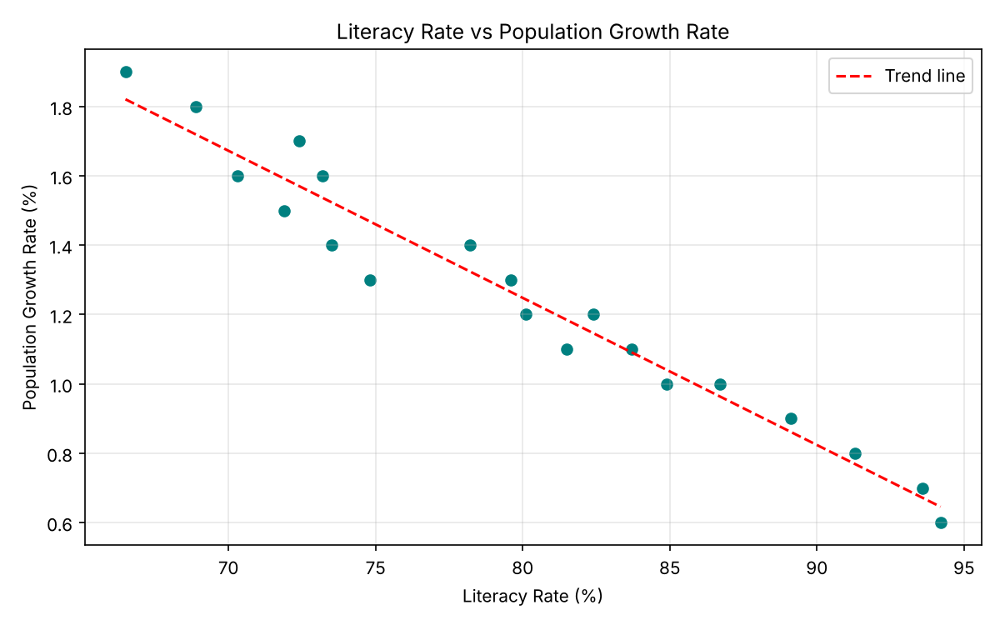
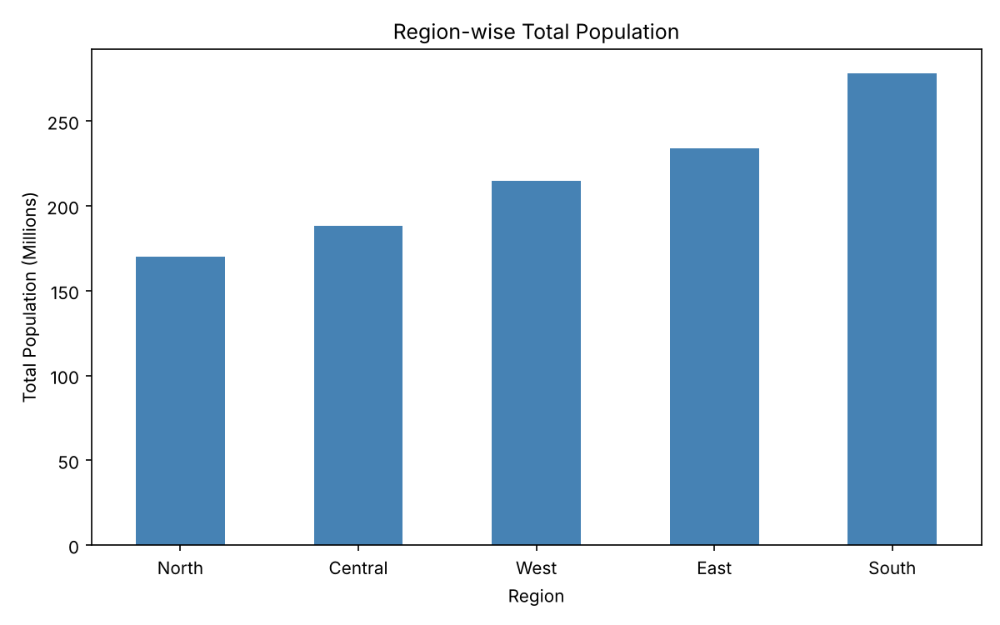

# Population Data Analytics Mini Project

A Python mini project that analyses population, density, growth rate, literacy and urbanisation across states and regions using **pandas** and **matplotlib**.

## Objective

To explore a population dataset, find key patterns (largest, densest and fastest-growing states, regional differences) and visualise the relationship between literacy and population growth.

## Project Structure

```
Population-Data-Analytics/
├── population_analysis.py                # Main analysis script
├── population_data.csv                   # Sample dataset
├── make_pdfs.py                          # Generates the PDF files
├── Population_Analytics_Report.pdf       # Full project report
├── Chart_Literacy_vs_Growth.pdf          # Scatter plot (PDF)
├── Chart_Region_Population.pdf           # Bar chart (PDF)
├── Dataset_Population_Data.pdf           # Dataset table (PDF)
├── literacy_vs_growth.png                # Scatter plot with trend line
├── region_population.png                 # Region-wise population bar chart
└── README.md
```

## Dataset

`population_data.csv` has 20 states across 5 regions (North, South, East, West, Central).

| Column | Description |
|---|---|
| State | State name |
| Region | North / South / East / West / Central |
| Population_Millions | Population in millions |
| Area_Thousand_SqKm | Area in thousand sq km |
| Growth_Rate_Pct | Annual growth rate (%) |
| Literacy_Pct | Literacy rate (%) |
| Urban_Pct | Urban population (%) |

An extra column, `Density_per_SqKm`, is calculated in the script.

> **Note:** The dataset is fictional and created for academic demonstration. Replace it with real data (Census, World Bank, UN) for actual analysis.

## What the Script Does

1. Loads the CSV and checks shape and missing values
2. Calculates population density
3. Prints summary statistics
4. Finds top 5 most populated, densest and fastest-growing states
5. Groups data region-wise (total population, average growth, literacy, urban %)
6. Computes the correlation matrix
7. Saves two charts as PNG files

## Key Findings

- Total population in the sample: **1085.3 million**, average growth rate **1.26%**
- Most populated: Kilo (92.5M), Hotel (84.6M), November (76.8M)
- Densest: Delta, Echo, Sierra
- Fastest growing: Papa (1.9%), November (1.8%), Charlie (1.7%)
- South has the highest total population, the highest literacy and the lowest growth rate
- Central has the lowest literacy and the highest growth rate
- Literacy and growth rate show a very strong negative correlation (about -0.98) in this sample

## Charts

| Literacy vs Growth Rate | Region-wise Population |
|---|---|
|  |  |

## Requirements

- Python 3.8 or above
- pandas
- matplotlib
- reportlab (only needed for `make_pdfs.py`)

```
pip install pandas matplotlib reportlab
```

## How to Run

Keep the CSV and Python file in the same folder, then run:

```
python population_analysis.py
```

This prints the analysis in the terminal and saves both charts. To regenerate the PDFs:

```
python make_pdfs.py
```

## Tools Used

- Python
- pandas
- matplotlib
- reportlab

## Future Improvements

- Use real census data
- Add year-wise trend and population forecasting
- Build an interactive dashboard (Streamlit or Power BI)

## License

This project is for educational purposes.
